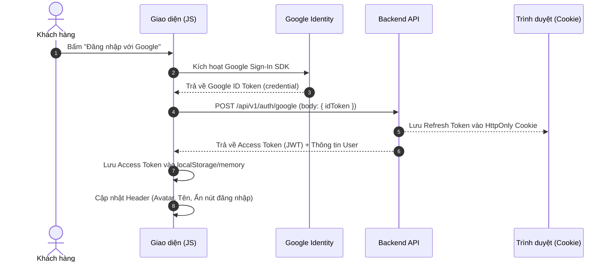

# Kiến trúc Frontend — Dự án Web Bán Hàng Tôn Thép

Tài liệu này mô tả kiến trúc kỹ thuật của hệ thống Frontend (sử dụng công nghệ thuần HTML5, CSS3, ES6 JavaScript) và cách giao tiếp với Backend Spring Boot 4.

---

## 1. Mô hình Ứng dụng: Modular Multi-Page Application (MPA) theo Thư mục Chức năng

Dự án áp dụng mô hình **Multi-Page Application (MPA)** kết hợp với **ES6 JavaScript Modules**, tổ chức cấu trúc trang theo **Thư mục chức năng / Phân hệ (Feature-based Directories)**:
- Trang chủ chính `index.html` nằm tại thư mục gốc đóng vai trò Landing Page.
- Tất cả các trang chức năng khác được gom nhóm rõ ràng trong thư mục `pages/` theo phân hệ nghiệp vụ (`auth/`, `product/`, `customer/`, `admin/`).
- Tách biệt hoàn toàn ranh giới giữa Khách hàng (Customer) và Nhân viên Quản lý (Admin/Manager), tránh trùng tên file và dễ thiết lập cơ chế kiểm soát truy cập (Route Guard).
- Không dùng framework nặng (như React/Angular/Vue) nhằm giữ độ nhẹ tối đa, tốc độ tải trang nhanh, không phụ thuộc vào công cụ đóng gói (bundler) phức tạp.
- Sử dụng native `<script type="module">` để chia nhỏ logic thành các module có thể tái sử dụng (`import` / `export`).

```mermaid
graph TD
    User([Người dùng / Trình duyệt]) --> Root[Trang chủ: index.html]
    User --> FeaturePages[Trang chức năng: pages/{module}/*.html]
    Root --> PageScript[Page Controller: js/pages/*.js]
    FeaturePages --> PageScript
    PageScript --> Components[Components: Header, Footer, Toast, Modal]
    PageScript --> ApiModules[API Modules: product.api.js, order.api.js...]
    ApiModules --> Client[HTTP Wrapper: client.js]
    Client -->|HTTP Request: Bearer JWT + Cookie| Backend[Spring Boot Backend API]
```

---

## 2. Phân tầng Kiến trúc Mã nguồn

```text
sales-frontend/
├── index.html                  # Trang chủ (Root Landing Page)
│
├── pages/                      # Tầng hiển thị giao diện theo Phân hệ Chức năng
│   ├── auth/                   # 1. Phân hệ Xác thực & Tài khoản
│   │   ├── login.html          # Đăng nhập Google & Nhân viên
│   │   └── callback.html       # Xử lý chuyển hướng OAuth2
│   ├── product/                # 2. Phân hệ Danh mục & Sản phẩm Tôn sóng
│   │   ├── catalog.html        # Phân loại tôn, bộ lọc thương hiệu/độ dày
│   │   └── detail.html         # Chi tiết sản phẩm, bảng giá, chọn màu
│   ├── customer/               # 3. Phân hệ Khách hàng Đặt hàng
│   │   ├── order.html          # Form đặt hàng & xác thực OTP số điện thoại
│   │   ├── my-orders.html      # Theo dõi đơn hàng & hoàn tác hủy (undo-cancel)
│   │   └── profile.html        # Thông tin cá nhân & sổ địa chỉ
│   └── admin/                  # 4. Cổng Quản lý & Quản trị viên (Manager/Admin)
│       ├── dashboard.html      # Tổng quan thống kê & chỉ số
│       ├── orders.html         # Xử lý đơn hàng, nhập đơn giá / chiết khấu & confirm
│       ├── products.html       # Quản lý danh mục, tôn, biến thể & tải ảnh
│       └── master-data.html    # Quản trị thương hiệu, đơn vị tính, màu sắc R2
│
├── assets/                     # Tài nguyên giao diện tĩnh
│   ├── css/                    # Phân tầng CSS 3 lớp (Base -> Components -> Pages)
│   └── images/                 # Ảnh tĩnh, logo, icon, banner
│
└── js/                         # Tầng logic xử lý
    ├── api/                    # Tầng giao tiếp mạng (Data Access Layer)
    ├── components/             # Tầng thành phần UI dùng chung
    ├── pages/                  # Tầng điều khiển trang (Page Controllers)
    └── utils/                  # Tầng tiện ích dùng chung
```

### Quy tắc đường dẫn tương đối (Relative Path Rules):
- **Trang gốc (`index.html`)**: Nhúng CSS/JS qua `./assets/css/...` và `./js/...`
- **Trang trong phân hệ (`pages/{module}/*.html`)**: Phải lùi 2 cấp thư mục:
  - CSS: `../../assets/css/...`
  - JavaScript: `../../js/...`
  - Ảnh: `../../assets/images/...`

### Chi tiết các tầng:
1. **Tầng Giao tiếp Mạng (`js/api/`)**:
   - `client.js`: Lớp nền tảng duy nhất trực tiếp gọi hàm `fetch()`. Tự động đính kèm `Authorization: Bearer <token>`, cấu hình `credentials: 'include'`, giải mã envelope `{ statusCode, data, message }`, và thực hiện **Silent Refresh** khi nhận lỗi 401 Unauthorized.
   - `*.api.js`: Các hàm nghiệp vụ cụ thể (ví dụ: `getProducts()`, `createOrder()`). Tuyệt đối không chứa logic thao tác với DOM.
2. **Tầng Điều khiển Trang (`js/pages/`)**:
   - Mỗi file HTML có một file controller tương ứng (ví dụ: `product-detail.html` nạp `js/pages/product-detail.js`).
   - Nhiệm vụ: Lắng nghe sự kiện `DOMContentLoaded`, gọi API lấy dữ liệu, bắt sự kiện click/submit của người dùng và cập nhật DOM.
3. **Tầng Thành phần Dùng chung (`js/components/`)**:
   - `header.js`: Tự động render menu danh mục đa cấp, kiểm tra trạng thái đăng nhập để hiển thị nút Đăng nhập hoặc Tên khách hàng.
   - `toast.js`: Hiển thị thông báo popup nổi (Thành công, Lỗi, Cảnh báo).
   - `modal-otp.js`: Điều khiển hộp thoại nhập mã OTP 6 số và đếm ngược thời gian.

---

## 3. Luồng Xác thực & Quản lý Phiên (Authentication & Token Lifecycle)

Dự án áp dụng mô hình bảo mật chuẩn OAuth2 Resource Server kết hợp với Refresh Token:



### Luồng Tự Động Làm Mới Token (Silent Refresh):
Khi Access Token hết hạn (thường sau 15–60 phút):
1. Người dùng thực hiện thao tác (ví dụ: Xem lịch sử đơn hàng `GET /api/v1/orders`).
2. Backend trả về HTTP `401 Unauthorized`.
3. `client.js` bắt được mã 401, tạm hoãn request hiện tại.
4. `client.js` tự động gửi request ngầm `POST /api/v1/auth/refresh` (trình duyệt tự gửi kèm Cookie HttpOnly chứa Refresh Token).
5. Backend cấp lại Access Token mới.
6. `client.js` cập nhật Access Token mới và **tự động gọi lại request ban đầu** mà người dùng không nhận biết gián đoạn.
7. Nếu việc refresh thất bại (Refresh Token hết hạn hoặc bị thu hồi), hệ thống chuyển hướng người dùng về trang Đăng nhập hoặc hiển thị popup báo phiên làm việc kết thúc.

---

## 4. Đặc thù Nghiệp vụ Tôn sóng Lợp mái

### a. Công thức Tính giá Sản xuất
- Tôn lợp mái được đặt hàng theo kích thước linh hoạt, công thức chuẩn từ Backend:
  $$\text{Tổng tiền} = \text{Đơn giá (UnitPrice)} \times \text{Chiều dài (Size - mét)} \times \text{Số lượng (Quantity - tấm)}$$
- Giao diện chi tiết sản phẩm và giỏ hàng phải hỗ trợ nhập `size` là số thập phân (ví dụ: `5.5m`, `6.2m`). Khi người dùng thay đổi chiều dài hoặc số lượng, giao diện tự động tính nhẩm tổng tiền hiển thị (nếu có giá).

### b. Kiểm soát Quyền xem Giá (`PRODUCT_PRICE_VIEW`)
- Backend kiểm soát động: Người dùng chưa có quyền xem giá sẽ nhận trường giá trị là `null`.
- Frontend xử lý:
  - Kiểm tra `if (item.price === null || item.price === undefined)`:
  - Hiển thị badge: `<span class="badge-contact">Liên hệ báo giá</span>`.
  - Khóa ô tính nhẩm giá, chỉ cho phép đặt hàng yêu cầu báo giá.

### c. Quy trình Xác thực Số điện thoại nhận hàng qua OTP
- Khách hàng khi đặt đơn hàng bắt buộc phải xác thực số điện thoại qua OTP (được lưu và kiểm tra bảo chứng trên Redis):
  1. Người dùng nhập SĐT nhận hàng.
  2. Bấm "Gửi mã OTP": UI gọi `POST /api/v1/orders/otp/request`.
  3. Modal OTP hiển thị, bắt đầu đếm ngược 60 giây.
  4. Người dùng nhập 6 chữ số: UI gọi `POST /api/v1/orders/otp/verify`.
  5. Khi thành công, Redis lưu bảo chứng `otp:verified:{phone}`, giao diện kích hoạt nút "Xác nhận đặt hàng" để gọi `POST /api/v1/orders`.

### d. Ảnh Mẫu Sản phẩm Mặc định (Fallback Placeholder)
- Khi sản phẩm chưa được tải ảnh lên từ Backend (`primaryImageUrl` hoặc mảng `images` rỗng/null, hoặc link ảnh bị lỗi mạng/404):
  - Giao diện (Trang chủ, Chi tiết sản phẩm, Danh mục...) bắt buộc hiển thị ảnh mặc định `assets/images/empty-picture.png` (dùng đường dẫn tương đối phù hợp cấp thư mục).
  - Tự động gán sự kiện `img.onerror` trên các thẻ `` để lập tức fallback về `empty-picture.png` nếu link ảnh bị hỏng, tránh hiện icon vỡ ảnh trên trình duyệt.

---

## 5. Quy tắc Tách biệt Template HTML và Tiêu chuẩn BEM trong CSS

### a. Mẫu Thiết kế Thẻ `<template>` (HTML/JS Separation)
Để giữ mã nguồn sạch sẽ, tránh hiện tượng trộn code HTML/CSS vào file JavaScript:
1. **Khung giao diện nằm 100% trong file `.html`**: Mọi phần tử động (thẻ sản phẩm, hàng giỏ hàng, bảng đơn hàng) được định nghĩa trong thẻ `<template id="...">` với đầy đủ các class CSS chuẩn BEM.
2. **Kiểu dáng nằm 100% trong file `.css`**: Không dùng inline `style="..."`.
3. **JavaScript chỉ làm nhiệm vụ Data Binding**:
   - Nhân bản template: `const clone = template.content.cloneNode(true);`
   - Tìm phần tử và gán giá trị: `clone.querySelector('.class-name').textContent = data.value;`
   - Đưa vào DOM: `container.appendChild(clone);`

### b. Tiêu chuẩn BEM trong CSS

Tất cả class CSS của các thành phần giao diện đều tuân theo quy ước đặt tên BEM:
- **Block**: Thành phần độc lập (ví dụ: `.header`, `.nav`, `.product-card`, `.modal`).
- **Element**: Phần tử con bên trong Block (ví dụ: `.product-card__image`, `.product-card__title`, `.product-card__price`).
- **Modifier**: Trạng thái hoặc biến thể (ví dụ: `.product-card--featured`, `.btn--primary`, `.btn--outline`, `.btn--disabled`).

---

## 6. Hệ thống Quản lý Bản dịch Tập trung (Centralized Translation Architecture)

Toàn bộ việc Việt hóa giao diện được điều phối tập trung qua module `js/utils/i18n.js` theo mô hình **3 Trụ Cột Độc Lập**:

1. **`fieldTranslations`**: Quản lý tên trường và nhãn dữ liệu (`translateField(fieldName, domain)`).
   - Phân theo Domain: Product, Order, User, Address, Category, MasterData, và Common.
   - Hỗ trợ kế thừa từ nhóm trường dùng chung `COMMON_FIELDS` và fallback tự động chuyển camelCase sang chuỗi đọc được khi chưa có bản dịch.
2. **`enumTranslations`**: Quản lý giá trị Enum và trạng thái nghiệp vụ (`translateEnum`, `translateOrderStatus`, `translateProductStatus`...).
   - Không phân biệt chữ hoa / thường (`trim().toUpperCase()`).
   - Xử lý an toàn `null`, `undefined`, chuỗi rỗng.
   - Bảo toàn giá trị gốc nếu Backend bổ sung Enum mới chưa kịp khai báo, tránh làm gián đoạn giao diện.
   - Đi kèm hàm `getStatusBadgeClass(status)` để đồng bộ màu sắc badge trạng thái theo chuẩn BEM (`badge--success`, `badge--warning`, `badge--danger`, `badge--info`).
3. **`messageTranslations`**: Quản lý thông điệp hệ thống và mã lỗi từ API (`translateMessage(msg)`).
   - Tự động nhận diện chuỗi có dấu tiếng Việt: **Nếu Backend đã trả về tiếng Việt, giữ nguyên 100% không dịch lại.**
   - Chuyển ngữ các thông báo lỗi tiếng Anh chuẩn của Spring Boot/Security sang tiếng Việt thân thiện với người dùng.

### Nguyên tắc Bất biến:
- **Bảo toàn dữ liệu mạng**: Không bao giờ gửi chuỗi tiếng Việt lên Backend. Payload gửi đi phải là Enum và thuộc tính tiếng Anh chuẩn của API contract (`../sales-backend/api-spec.md`).
- **Phân tách rạch ròi**: Thuộc tính code giữ nguyên tiếng Anh (`item.thickness`), chỉ nhãn hiển thị mới dịch thành tiếng Việt (`Độ dày`).
- **Nghiêm cấm rải rác**: Cấm tuyệt đối viết `switch/case` hoặc `if/else` để dịch trạng thái rải rác trong từng component/page.


