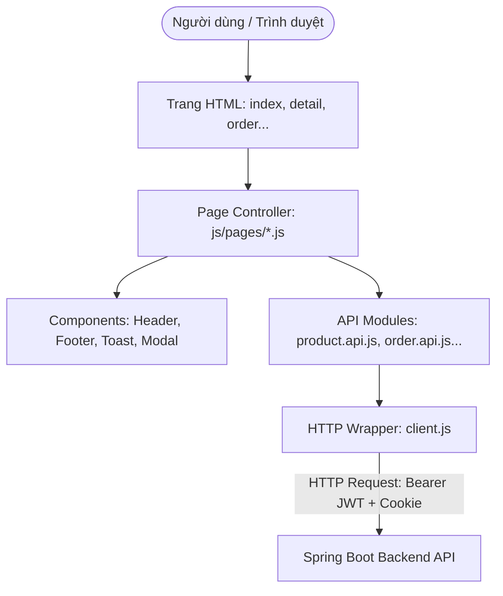
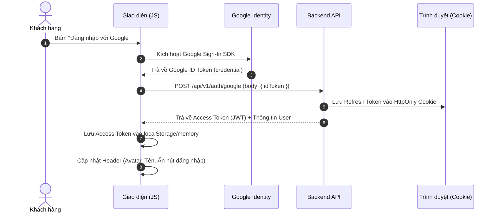

# Kiến trúc Frontend — Dự án Web Bán Hàng Tôn Thép

Tài liệu này mô tả kiến trúc kỹ thuật của hệ thống Frontend (sử dụng công nghệ thuần HTML5, CSS3, ES6 JavaScript) và cách giao tiếp với Backend Spring Boot 4.

---

## 1. Mô hình Ứng dụng: Modular Multi-Page Application (MPA)

Dự án áp dụng mô hình **Multi-Page Application (MPA)** kết hợp với **ES6 JavaScript Modules**:
- Mỗi trang chức năng là một file HTML độc lập (`index.html`, `product-detail.html`, `order.html`, `my-orders.html`).
- Không dùng framework nặng (như React/Angular/Vue) nhằm giữ độ nhẹ tối đa, tốc độ tải trang nhanh, không phụ thuộc vào công cụ đóng gói (bundler) phức tạp.
- Sử dụng native `<script type="module">` để chia nhỏ logic thành các module có thể tái sử dụng (`import` / `export`).



---

## 2. Phân tầng Kiến trúc Mã nguồn

```text
sales-frontend/
├── assets/             # Tài nguyên giao diện tĩnh
│   ├── css/            # Phân tầng CSS 3 lớp (Base -> Components -> Pages)
│   └── images/         # Ảnh tĩnh, logo, icon
├── js/                 # Tầng logic xử lý
│   ├── api/            # Tầng giao tiếp mạng (Data Access Layer)
│   ├── components/     # Tầng thành phần UI dùng chung
│   ├── pages/          # Tầng điều khiển trang (Page Controllers)
│   └── utils/          # Tầng tiện ích dùng chung
└── *.html              # Tầng hiển thị giao diện
```

### Chi tiết các tầng:
1. **Tầng Giao tiếp Mạng (`js/api/`)**:
   - `client.js`: Lớp nền tảng duy nhất trực tiếp gọi hàm `fetch()`. Tự động đính kèm `Authorization: Bearer <token>`, cấu hình `credentials: 'include'`, giải mã envelope `{ statusCode, data, message }`, và thực hiện **Silent Refresh** khi nhận lỗi 401 Unauthorized.
   - `*.api.js`: Các hàm nghiệp vụ cụ thể (ví dụ: `getProducts()`, `createOrder()`). Tuyệt đối không chứa logic thao tác với DOM.
2. **Tầng Điều khiển Trang (`js/pages/`)**:
   - Mỗi file HTML có một file controller tương ứng (ví dụ: `product-detail.html` nạp `js/pages/product-detail.js`).
   - Nhiệm vụ: Lắng nghe sự kiện `DOMContentLoaded`, gọi API lấy dữ liệu, bắt sự kiện click/submit của người dùng và cập nhật DOM.
3. **Tầng Thành phần Dùng chung (`js/components/`)**:
   - `header.js`: Tự động render menu danh mục đa cấp, kiểm tra trạng thái đăng nhập để hiển thị nút Đăng nhập hoặc Tên khách hàng.
   - `toast.js`: Hiển thị thông báo popup nổi (Thành công, Lỗi, Cảnh báo).
   - `modal-otp.js`: Điều khiển hộp thoại nhập mã OTP 6 số và đếm ngược thời gian.

---

## 3. Luồng Xác thực & Quản lý Phiên (Authentication & Token Lifecycle)

Dự án áp dụng mô hình bảo mật chuẩn OAuth2 Resource Server kết hợp với Refresh Token:



### Luồng Tự Động Làm Mới Token (Silent Refresh):
Khi Access Token hết hạn (thường sau 15–60 phút):
1. Người dùng thực hiện thao tác (ví dụ: Xem lịch sử đơn hàng `GET /api/v1/orders`).
2. Backend trả về HTTP `401 Unauthorized`.
3. `client.js` bắt được mã 401, tạm hoãn request hiện tại.
4. `client.js` tự động gửi request ngầm `POST /api/v1/auth/refresh` (trình duyệt tự gửi kèm Cookie HttpOnly chứa Refresh Token).
5. Backend cấp lại Access Token mới.
6. `client.js` cập nhật Access Token mới và **tự động gọi lại request ban đầu** mà người dùng không nhận biết gián đoạn.
7. Nếu việc refresh thất bại (Refresh Token hết hạn hoặc bị thu hồi), hệ thống chuyển hướng người dùng về trang Đăng nhập hoặc hiển thị popup báo phiên làm việc kết thúc.

---

## 4. Đặc thù Nghiệp vụ Tôn sóng Lợp mái

### a. Công thức Tính giá Sản xuất
- Tôn lợp mái được đặt hàng theo kích thước linh hoạt, công thức chuẩn từ Backend:
  $$\text{Tổng tiền} = \text{Đơn giá (UnitPrice)} \times \text{Chiều dài (Size - mét)} \times \text{Số lượng (Quantity - tấm)}$$
- Giao diện chi tiết sản phẩm và giỏ hàng phải hỗ trợ nhập `size` là số thập phân (ví dụ: `5.5m`, `6.2m`). Khi người dùng thay đổi chiều dài hoặc số lượng, giao diện tự động tính nhẩm tổng tiền hiển thị (nếu có giá).

### b. Kiểm soát Quyền xem Giá (`PRODUCT_PRICE_VIEW`)
- Backend kiểm soát động: Người dùng chưa có quyền xem giá sẽ nhận trường giá trị là `null`.
- Frontend xử lý:
  - Kiểm tra `if (item.price === null || item.price === undefined)`:
  - Hiển thị badge: `<span class="badge-contact">Liên hệ báo giá</span>`.
  - Khóa ô tính nhẩm giá, chỉ cho phép đặt hàng yêu cầu báo giá.

### c. Quy trình Xác thực Số điện thoại nhận hàng qua OTP
- Khách hàng khi đặt đơn hàng bắt buộc phải xác thực số điện thoại qua OTP (được lưu và kiểm tra bảo chứng trên Redis):
  1. Người dùng nhập SĐT nhận hàng.
  2. Bấm "Gửi mã OTP": UI gọi `POST /api/v1/orders/otp/request`.
  3. Modal OTP hiển thị, bắt đầu đếm ngược 60 giây.
  4. Người dùng nhập 6 chữ số: UI gọi `POST /api/v1/orders/otp/verify`.
  5. Khi thành công, Redis lưu bảo chứng `otp:verified:{phone}`, giao diện kích hoạt nút "Xác nhận đặt hàng" để gọi `POST /api/v1/orders`.

---

## 5. Quy tắc Tách biệt Template HTML và Tiêu chuẩn BEM trong CSS

### a. Mẫu Thiết kế Thẻ `<template>` (HTML/JS Separation)
Để giữ mã nguồn sạch sẽ, tránh hiện tượng trộn code HTML/CSS vào file JavaScript:
1. **Khung giao diện nằm 100% trong file `.html`**: Mọi phần tử động (thẻ sản phẩm, hàng giỏ hàng, bảng đơn hàng) được định nghĩa trong thẻ `<template id="...">` với đầy đủ các class CSS chuẩn BEM.
2. **Kiểu dáng nằm 100% trong file `.css`**: Không dùng inline `style="..."`.
3. **JavaScript chỉ làm nhiệm vụ Data Binding**:
   - Nhân bản template: `const clone = template.content.cloneNode(true);`
   - Tìm phần tử và gán giá trị: `clone.querySelector('.class-name').textContent = data.value;`
   - Đưa vào DOM: `container.appendChild(clone);`

### b. Tiêu chuẩn BEM trong CSS

Tất cả class CSS của các thành phần giao diện đều tuân theo quy ước đặt tên BEM:
- **Block**: Thành phần độc lập (ví dụ: `.header`, `.nav`, `.product-card`, `.modal`).
- **Element**: Phần tử con bên trong Block (ví dụ: `.product-card__image`, `.product-card__title`, `.product-card__price`).
- **Modifier**: Trạng thái hoặc biến thể (ví dụ: `.product-card--featured`, `.btn--primary`, `.btn--outline`, `.btn--disabled`).

